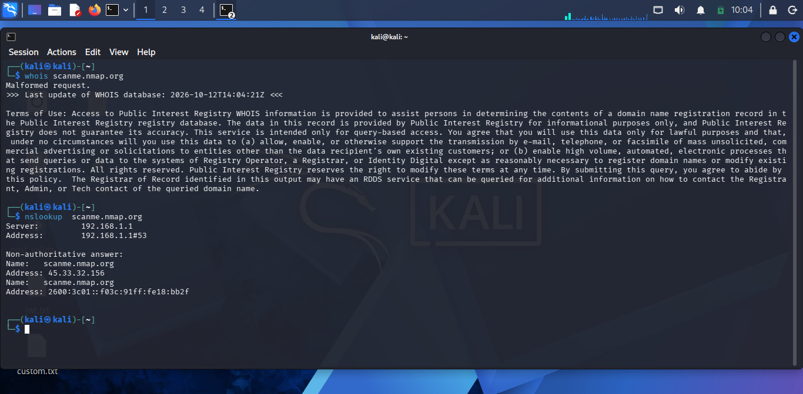

# Task 2 — Network Security & Scanning

## Objective
Learn reconnaissance, scanning, and network traffic analysis techniques against the lab target.

## 1. Reconnaissance
Performed passive recon (Whois, Nslookup, Google Dorking, Shodan) and active recon (ping sweep, banner grabbing) against the lab target to gather host and service information before scanning.

Screenshots: 
nslookup_whois output:  
Google Dork Results: 
Shodan Search Result: 
active recon Output: 

## 2. Port & Service Scanning
Ran Nmap TCP (-sS) and UDP (-sU) scans against Metasploitable2, followed by service version detection (-sV) and OS detection (-O) to build a full picture of open ports and running services.

Screenshots: /screenshots/scanning
Nmap TCP Scan: 
Nmap UDP Scan: 
Nmap Service Version Detection: 
Nmap OS Detection: 

## 3. Vulnerability Scanning
Set up OpenVAS and scanned the Metasploitable2 VM, then analyzed the resulting report by severity (Critical/High/Medium/Low).

Screenshots: /screenshots/vuln-scan
OpenVAS Setup
Vulnerability Scan Report

## 4. Packet Analysis with Wireshark
Captured HTTP, FTP, and DNS traffic on the lab network, filtered out credentials from unencrypted FTP traffic, and analyzed a simulated SYN flood attack generated with hping3.

Screenshots: /screenshots/packet-analysis
HTTP/FTP/DNS Capture
FTP Credentials Filter
SYN Flood Analysis

## 5. Firewall Basics
Created iptables rules to allow/deny specific ports, then demonstrated blocking an active port scan attempt.

Screenshots: /screenshots/firewall
Iptables Rules
Blocked Port Scan
